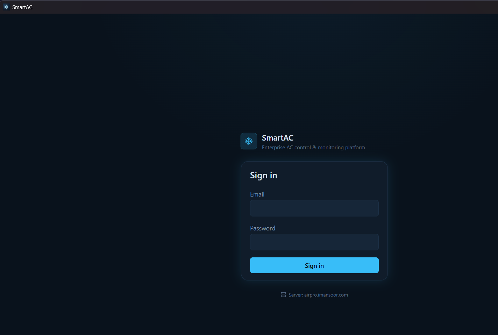

# SmartAC — Downloads

Native apps for the SmartAC platform: control and monitor split air conditioners across an
estate, with live telemetry, per-unit energy accounting, scheduling and alerts.

**[⬇ Download the latest release](https://github.com/m4mansoor/SmartAC-releases/releases/latest)**



---

## Availability

| Platform | Status |
|----------|--------|
| **Windows** 10/11 (64-bit) | **Available** — installer on the [releases page](https://github.com/m4mansoor/SmartAC-releases/releases/latest) |
| macOS | Planned — pending an Apple Developer account for notarization |
| Android | Planned |
| iOS | Planned — pending an Apple Developer account |

All four are built from one codebase, so the later platforms are a build step rather than a
rewrite.

---

## Installing on Windows

1. Download `SmartAC_<version>_x64-setup.exe` from the
   [latest release](https://github.com/m4mansoor/SmartAC-releases/releases/latest).
2. Run it. Windows will show a blue **"Windows protected your PC"** screen.
3. Click **More info**, then **Run anyway**.

That warning is expected right now: the installer is not yet code-signed. A signing
certificate is being purchased, and once it is in place the warning goes away by itself.
Until then, you can confirm you have the genuine file by checking its SHA-256 against the
checksum published on the release page:

```powershell
Get-FileHash .\SmartAC_0.1.0_x64-setup.exe -Algorithm SHA256
```

An `.msi` is also published for deployment through group policy or an MDM.

The app installs for the current user and needs no administrator rights.

### Requirements

- Windows 10 version 1803 or newer, 64-bit
- **WebView2 runtime** — already present on Windows 11 and on up-to-date Windows 10. The
  installer fetches it automatically if it is missing.
- Network access to your SmartAC server

---

## Connecting to a server

The app ships pointing at the hosted SmartAC service, so for most people it just works —
sign in and you are on your estate.

If you run your own server, open the app and set the server address on the sign-in screen,
or set it once from the browser console (`F12`) before signing in:

```js
localStorage.setItem('smartac-server-url', 'https://smartac.yourcompany.com');
location.reload();
```

Clear it with `localStorage.removeItem('smartac-server-url')` to go back to the default.

---

## Which file do I want?

| File | Use it when |
|------|-------------|
| `SmartAC_<version>_x64-setup.exe` | Normal install. This is the one you want. |
| `SmartAC_<version>_x64_en-US.msi` | Deploying across an organization via GPO/MDM |

---

## Reporting a problem

Open an issue on this repository with your Windows version, the app version (shown on the
sign-in screen), and what you were doing. Screenshots help.

Source code lives in a private repository; this one exists purely to host downloads.
